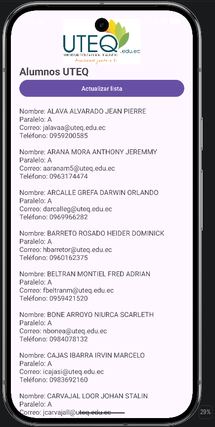
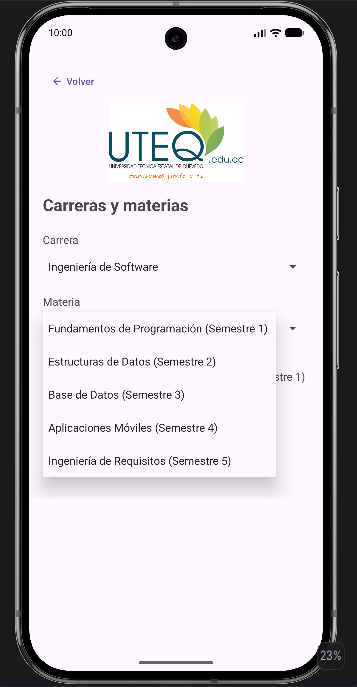

# Práctica 02: Integración de Supabase en Android con Kotlin

**Universidad Técnica Estatal de Quevedo (UTEQ)**
Facultad de Ciencias de la Ingeniería | Carrera de Software
Asignatura: Aplicaciones Móviles (ISR-602) | Sexto nivel

Aplicación Android nativa (Kotlin + XML) que se conecta a **Supabase** mediante el SDK para Kotlin, consulta la tabla `public.alumnos` y muestra los registros en orden alfabético, con indicador de carga y manejo de errores.

## Capturas de la aplicación

<p align="center">
  
  &nbsp;&nbsp;
  
</p>

<p align="center"><em>Lista de alumnos (izquierda) y selección de carrera y materia (derecha).</em></p>

## Objetivos

- Configurar un proyecto Android con dependencias Gradle.
- Crear una tabla relacional en PostgreSQL (Supabase) y aplicar Row Level Security (RLS).
- Modelar los datos con una clase `@Serializable`.
- Centralizar el cliente de Supabase como un objeto único (Singleton).
- Consultar datos de forma asíncrona con corutinas desde una `Activity`.

## Tecnologías

| Herramienta | Versión |
|---|---|
| Kotlin | 2.2.10 |
| Android Gradle Plugin | 9.5.1 |
| Supabase Kotlin SDK (BOM) | 3.6.0 |
| Ktor Client OkHttp | 3.5.0 |
| Lifecycle Runtime KTX | 2.9.2 |
| Material Components | 1.14.0 |
| Interfaz | Android XML (Views) |

## Arquitectura

```
Supabase (tabla + RLS)  →  Gradle (SDK + permisos)  →  Kotlin (modelo + consulta)  →  Android UI (lista + errores)
```

### Estructura del proyecto

```
app/src/main/
├── AndroidManifest.xml
├── java/com/uteq/practica01_s4/
│   ├── MainActivity.kt
│   ├── MainActivity2.kt
│   ├── data/SupabaseManager.kt
│   ├── models/
│   │   ├── Alumno.kt
│   │   ├── Carrera.kt
│   │   └── Materia.kt
│   └── utils/SupabaseErrorHandler.kt
└── res/
    ├── drawable/
    │   ├── ic_arrow_back.xml
    │   └── logo_uteq.png
    └── layout/
        ├── activity_main.xml
        └── activity_main2.xml
docs/
└── supabase_carreras_materias.sql
```

| Archivo | Responsabilidad |
|---|---|
| `SupabaseManager.kt` | Singleton (`object`) que crea el cliente Supabase con el módulo Postgrest, motor OkHttp y timeout de 15 s. |
| `Alumno.kt` | Modelo `@Serializable` que representa una fila de la tabla. |
| `Carrera.kt` / `Materia.kt` | Modelos de las tablas `carreras` y `materias`; `toString()` define el texto del combo. |
| `SupabaseErrorHandler.kt` | Muestra un diálogo Material cuando la conexión o la consulta falla (mensaje propio para timeout). |
| `MainActivity.kt` | Consulta con `lifecycleScope`, ordena por `nombres` y presenta el resultado. Abre `MainActivity2`. |
| `MainActivity2.kt` | Combos de carrera y materia; las materias se filtran por la carrera elegida. |
| `activity_main.xml` | Logo, título, botones *Actualizar lista* y *Carreras y materias*, `ProgressBar` y resultados. |
| `activity_main2.xml` | Botón *Volver*, logo, dos `Spinner` (carrera y materia), `ProgressBar` y texto de selección. |

## 1. Base de datos en Supabase

### Crear la tabla

```sql
create table if not exists public.alumnos (
    id bigint generated by default as identity primary key,
    created_at timestamptz not null default now(),
    foto varchar(500) null,
    nombres varchar(200) not null,
    correo varchar(150) null,
    paralelo char(1) not null,
    telefono varchar(20) null
);
```

### Datos de demostración

```sql
insert into public.alumnos
    (nombres, paralelo, correo, telefono, foto)
values
    ('ANA EJEMPLO', 'A', 'ana@example.com', null, null),
    ('BRUNO DEMO', 'A', 'bruno@example.com', null, null),
    ('CARLA PRUEBA', 'B', 'carla@example.com', null, null);
```

### Verificar

```sql
select id, nombres, paralelo, correo, telefono
from public.alumnos
order by nombres asc;
```

### RLS (solo para demostración con datos ficticios)

```sql
alter table public.alumnos enable row level security;

create policy "lectura_demo_alumnos"
on public.alumnos
for select
to anon
using (true);
```

> **Advertencia:** esta política permite lectura anónima. No debe usarse con datos personales reales. En un sistema real se requiere autenticación y reglas RLS por usuario.

## 2. Configuración de credenciales

Las credenciales se guardan en `local.properties` (raíz del proyecto), que **no se sube a Git**:

```properties
SUPABASE_URL=https://TU_PROYECTO.supabase.co
SUPABASE_KEY=TU_CLAVE_PUBLICABLE
```

- Sin comillas alrededor de los valores.
- Usar únicamente la **clave publicable** (o `anon`). **Nunca** una clave `service_role`.
- `.gitignore` debe incluir:

```
/local.properties
```

> `BuildConfig` evita escribir la clave en el código fuente, pero **no la oculta dentro de la APK**. Por eso solo se usan claves publicables y políticas RLS correctas.

## 3. Configuración de Gradle

**`build.gradle.kts` (raíz)**

```kotlin
plugins {
    alias(libs.plugins.android.application) apply false
    id("org.jetbrains.kotlin.plugin.serialization") version "2.2.10" apply false
}
```

> La versión del plugin de serialización debe coincidir con la versión de Kotlin del proyecto.

**`app/build.gradle.kts`**

```kotlin
import java.util.Properties

val props = Properties().apply {
    rootProject.file("local.properties").inputStream().use { load(it) }
}
val url = props.getProperty("SUPABASE_URL")
    ?: error("Falta SUPABASE_URL en local.properties")
val key = props.getProperty("SUPABASE_KEY")
    ?: error("Falta SUPABASE_KEY en local.properties")

plugins {
    alias(libs.plugins.android.application)
    id("org.jetbrains.kotlin.plugin.serialization")
}

android {
    buildFeatures { buildConfig = true }

    defaultConfig {
        buildConfigField("String", "SUPABASE_URL", "\"$url\"")
        buildConfigField("String", "SUPABASE_KEY", "\"$key\"")
    }
}

dependencies {
    implementation(platform("io.github.jan-tennert.supabase:bom:3.6.0"))
    implementation("io.github.jan-tennert.supabase:postgrest-kt")
    implementation("io.ktor:ktor-client-okhttp:3.5.0")
    implementation("androidx.lifecycle:lifecycle-runtime-ktx:2.9.2")
    implementation(libs.material)
}
```

**Permiso de internet (`AndroidManifest.xml`)**, dentro de `<manifest>` y antes de `<application>`:

```xml
<uses-permission android:name="android.permission.INTERNET" />
```

## 4. Código Kotlin

### Cliente único: `SupabaseManager.kt`

```kotlin
object SupabaseManager {
    val client = createSupabaseClient(
        supabaseUrl = BuildConfig.SUPABASE_URL,
        supabaseKey = BuildConfig.SUPABASE_KEY
    ) {
        httpEngine = OkHttp.create()
        requestTimeout = 15.seconds
        install(Postgrest)
    }
}
```

> Se usa el motor **OkHttp** en lugar de `ktor-client-android`: el motor de Android se bloquea mientras resuelve el DNS y el timeout no puede cortarlo, por lo que la app se quedaba cargando indefinidamente. Con OkHttp, a los 15 s se muestra el diálogo de error.

### Modelo: `Alumno.kt`

```kotlin
@Serializable
data class Alumno(
    val id: Long,
    val nombres: String,
    val paralelo: String,
    val correo: String? = null,
    val telefono: String? = null,
    val foto: String? = null,
    val created_at: String? = null
)
```

Los campos obligatorios en SQL son `String`; los opcionales son `String?` para admitir `NULL`.

### Consulta en `MainActivity.kt`

```kotlin
private fun consultarAlumnos() {
    lifecycleScope.launch {
        progressMaterias.visibility = View.VISIBLE
        try {
            val alumnos = SupabaseManager.client
                .from("alumnos")
                .select { order("nombres", Order.ASCENDING) }
                .decodeList<Alumno>()

            txtAlumnos.text = if (alumnos.isEmpty()) {
                "No se encontraron alumnos."
            } else {
                alumnos.joinToString("\n\n") { a ->
                    "Nombre: ${a.nombres}\n" +
                    "Paralelo: ${a.paralelo}\n" +
                    "Correo: ${a.correo ?: "Sin registrar"}\n" +
                    "Teléfono: ${a.telefono ?: "Sin registrar"}"
                }
            }
        } catch (e: Exception) {
            SupabaseErrorHandler.show(this@MainActivity, e)
        } finally {
            progressMaterias.visibility = View.GONE
        }
    }
}
```

## 5. Carreras y materias (actividad 2) — 24/11/2026

Segunda pantalla con dos combos (`Spinner`) cuyos datos vienen de Supabase: al elegir una **carrera** se cargan solo sus **materias**, ordenadas por semestre.

### Lo realizado

- Nueva actividad `MainActivity2` con los combos **Carrera** y **Materia**, indicador de carga y texto con la selección actual.
- Modelos `Carrera` y `Materia` (`@Serializable`, con `@SerialName("carrera_id")`).
- Botón **Carreras y materias** en la pantalla principal y botón **Volver** en la nueva pantalla.
- `MainActivity2` se declaró sin filtro `LAUNCHER` en el manifest (antes la app aparecía dos veces en el menú).
- Cliente Supabase con motor OkHttp y timeout de 15 s, y mensaje claro cuando la conexión expira.
- Script SQL con tablas, RLS y datos de ejemplo: [`docs/supabase_carreras_materias.sql`](docs/supabase_carreras_materias.sql).

### Tablas en Supabase

Ejecutar el script completo en **SQL Editor → New query → Run**. Resumen:

```sql
create table if not exists public.carreras (
    id          bigint generated always as identity primary key,
    nombre      text not null unique,
    created_at  timestamptz not null default now()
);

create table if not exists public.materias (
    id          bigint generated always as identity primary key,
    carrera_id  bigint not null references public.carreras (id) on delete cascade,
    nombre      text not null,
    semestre    smallint check (semestre between 1 and 10),
    created_at  timestamptz not null default now(),
    unique (carrera_id, nombre)
);

alter table public.carreras enable row level security;
alter table public.materias enable row level security;

create policy "lectura_carreras" on public.carreras for select to anon using (true);
create policy "lectura_materias" on public.materias for select to anon using (true);
```

El script también inserta 3 carreras y 10 materias de ejemplo y puede ejecutarse varias veces sin duplicar datos.

### Consulta de materias filtrada por carrera

```kotlin
val materias = SupabaseManager.client
    .from("materias")
    .select {
        filter { eq("carrera_id", carrera.id) }
        order("semestre", Order.ASCENDING)
        order("nombre", Order.ASCENDING)
    }
    .decodeList<Materia>()
```

Si se cambia de carrera antes de que termine la consulta anterior, esa consulta se cancela para que una respuesta lenta no sobrescriba la lista actual.

## 6. Cómo ejecutar el proyecto

1. Clonar el repositorio:
   ```bash
   git clone https://github.com/darcalleg-soft/PRACTICA01-S4-APPMOVIL.git
   ```
2. Crear un proyecto en Supabase y ejecutar los scripts SQL de la sección 1 y `docs/supabase_carreras_materias.sql`.
3. Crear `local.properties` en la raíz con `SUPABASE_URL` y `SUPABASE_KEY` (y `sdk.dir` si Android Studio no lo genera).
4. Abrir en Android Studio y pulsar **Sync Project with Gradle Files**.
5. Ejecutar en un emulador o dispositivo con **internet**.

## 7. Problemas frecuentes

| Situación | Causa probable / solución |
|---|---|
| Se queda cargando y no muestra la lista | El emulador no resuelve DNS porque la red bloquea el **DNS privado**. En el emulador: *Settings → Network & internet → Private DNS → Off*. |
| `Timeout waiting to lock Configuration Cache` | Otro proceso de Gradle quedó colgado. Cerrar y abrir Android Studio (o *File → Invalidate Caches → Restart*). |
| La app aparece dos veces en el menú | Dos actividades con filtro `LAUNCHER` en el manifest; dejarlo solo en `MainActivity`. |
| Combo de materias vacío | La carrera no tiene materias, o falta la política `lectura_materias`. |
| `Unresolved reference: BuildConfig` | Revisar `namespace`, el import y `buildFeatures.buildConfig`; hacer *Make Project*. |
| `Unresolved reference 'main'` | `MainActivity` conservaba el código de plantilla (`R.id.main`). Reemplazarlo. |
| Lista vacía | Revisar registros, nombre de tabla y política RLS. |
| 401 / invalid API key | Verificar URL y clave en `local.properties`. |
| Sin red / timeout | Verificar el permiso `INTERNET` y la conexión del emulador. |
| Error de serialización | Revisar `@Serializable`, el plugin y los campos opcionales. |
| Falla Gradle Sync | Revisar compatibilidad entre Kotlin, SDK, Ktor y plugins. |

## 8. Seguridad y datos personales

- `local.properties` está excluido del repositorio.
- La clave publicable viaja dentro de la APK: la seguridad real depende de las **políticas RLS**.
- La política `lectura_demo_alumnos` es solo para laboratorio. Con datos reales, eliminarla:
  ```sql
  drop policy "lectura_demo_alumnos" on public.alumnos;
  ```
- No exponer nombres, correos ni teléfonos reales en pantallas o capturas públicas.

## Autor

**Nombre:** _Su nombre completo_
**Curso:** Sexto nivel, Carrera de Software
**GitHub:** [darcalleg-soft](https://github.com/darcalleg-soft)